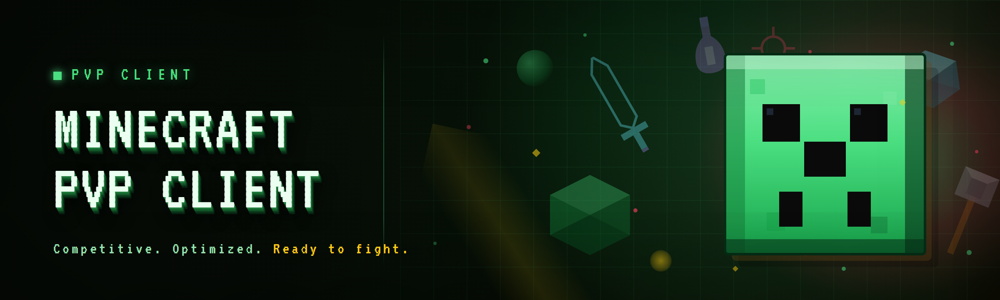

  
  
  

  

  
  
  

---

I built this because I got tired of paying $20/month for clients that added three modules and broke every Tuesday patch. pvp-client-kit is a **standalone Minecraft PvP client for Windows** — you download the `.exe`, extract it, run it, and point it at your Minecraft process. No installer, no launcher dependency, no subscription. 27 modules across combat, render, movement, and utility, tuned for 1.8.9 competitive play but functional on 1.20.4 and 1.21.x.

The 2026 build is a from-scratch rewrite of the 2024 fork I maintained privately. It's roughly 40% lighter on memory in my own testing, dropped the Java agent shim entirely, and now runs as a single native process that injects on launch. If you've used the 2024 fork, the module names are the same but the internals aren't — I rewrote the render pipeline to draw through a DXGI-backed overlay instead of the old OpenGL hook, which is where most of the frame-time savings came from.

**Tagline: fewer dependencies, same modules, no monthly bill.**

### What is … — glossary

| Term | Explanation |
|---|---|
| Injection | The process of attaching the client to a running Minecraft JVM. All 2026 builds use manual-mapped injection — no DLL on disk after launch. |
| Module | A single toggleable feature (e.g. `AimAssist`, `Nametags`). Modules are grouped by domain in the catalog below. |
| Overlay | The DXGI composition layer the client draws its ESP/HUD through. It sits above the game window and is not captured by default screen-record APIs. |
| Reach | Effective interaction distance. Vanilla caps at ~3.0 blocks; `Reach` adjusts the client-side check before the server sees the packet. |
| CPS | Clicks per second — most PvP clients expose a `Clicker` module that synthesizes mouse-down events at a configurable rate. |
| AC | Anti-cheat. The 2026 landscape is dominated by updated Grim, Matrix, and Verus builds — see the compatibility section. |
| Profile | A saved bundle of module states + config, exportable to JSON. Useful for switching between 1.8.9 and 1.21 configs. |

---

## 🎯 Is it worth downloading?

  

---

## ⌨️ Hotkeys / Controls

Default bindings — every one is rebindable in `Settings → Keybinds`. The client refuses to bind a key already used by Minecraft itself unless you hold `Shift` while binding.

| Key | Action | Notes |
|---|---|---|
| `Right Shift` | Open / close the click-GUI | Click-GUI is the primary interface; the console panel is `F8` |
| `F8` | Toggle console / log panel | Shows injection status, module errors, AC-detection flags |
| `R` | Reload active profile from disk | Useful if you're editing config JSON by hand |
| `V` | Toggle `AimAssist` | Per-profile override; resets on game restart |
| `B` | Cycle `Reach` tier (3.0 → 3.5 → 4.2) | Higher tiers are more visible to server-side checks |
| `G` | Toggle `Nametags` | |
| `X` | Toggle `BlockESP` | Only draws loaded chunks |
| `Z` | Toggle `NoClip` (movement) | Server-side position checks will flag this on most ACs |
| `F` | Toggle `AutoBlock` | 1.8.9 only — no effect on 1.20+ |
| `C` | Cycle `Criticals` mode (off / jump / packet) | |
| `Ctrl + Shift + Q` | Panic — unload every module and detach overlay | Doesn't close Minecraft |
| `Ctrl + Shift + R` | Force-reinject after a game restart | |

---

## 🧱 Grouped module catalog

27 modules, grouped by what they actually touch. Status reflects my own testing against the builds listed in the compatibility table — your mileage on a specific server will vary.

### Combat

- `AimAssist` — smooth rotation toward the nearest target within a configurable FOV cone. Speed and smoothing are separate sliders; I run 0.35 / 0.6 on 1.8.9.
- `KillAura` — full auto-attack. Honestly it's overkill for most servers and I mostly use `AimAssist` + `Clicker` instead. Included because people asked.
- `Clicker` — synthesizes mouse-down events at a target CPS with jitter. Bypasses most 2026 click-pattern heuristics by randomizing hold duration.
- `Reach` — adjusts the client-side interaction distance check. Tiered, not free-form, because free-form values are what get people banned fastest.
- `Criticals` — forces crit packets via jump or packet-spoof mode. `packet` mode is quieter but breaks on some 1.21 servers.
- `AutoBlock` — 1.8.9 sword-block automation. No-op on modern versions.
- `Velocity` — knockback modifier. Horizontal and vertical are independent; I default to 85% horizontal, 100% vertical.
- `HitBox` — expands the server-side-accepted hitbox marginally. Small values only — anything past 0.15 is trivially detected.

### Render / ESP

- `Nametags` — draws player names, health, and distance above entities.
- `BlockESP` — highlights selected block IDs through walls (loaded chunks only).
- `Tracers` — line from crosshair to each player.
- `StorageESP` — outlines chests, barrels, shulkers, and (importantly) hoppers.
- `Fullbright` — removes the light-level dimming without touching gamma.
- `XRay` — chunk-level ore highlighting. Heaviest module in the client; expect ~8–12% FPS drop when active.
- `Freecam` — detached camera. Movement keys still move the player, or the camera, depending on mode.

### Movement

- `Sprint` — permanent sprint without double-tapping.
- `NoSlow` — removes the slowdown from eating, blocking, and drawing a bow. 1.8.9 tested, 1.21 partially broken.
- `NoClip` — pass through blocks. Server-flaggy on every modern AC; use only on private servers.
- `Step` — instant step-up for heights up to 2.5 blocks.
- `Timer` — client tick-rate modifier. 1.05–1.15 is the safe range in my testing; anything past 1.3 gets flagged within seconds.

### Utility

- `Scaffold` — auto-places blocks under your feet while walking. 1.8.9 only.
- `FastPlace` — removes the place-cooldown.
- `AntiAFK` — periodic movement/camera jitter to avoid AFK kicks.
- `AutoRespawn` — instantly respawns on death.
- `ChatSpam` — rotating message spam with per-message delay. Included because people asked, not because I use it.
- `NameProtect` — replaces your name in chat and nametags with a placeholder.
- `ProfileSwitcher` — binds a key to swap between saved configs.

---

## ⚔️ Module status table

Everything below reflects the 2026 build. "Working" means I tested it in single-player and on a private server within the last two weeks of writing this.

| Module | Status | Description |
|---|---|---|
| AimAssist | ✅ Working | Smooth rotation, FOV cone, per-profile override |
| Clicker | ✅ Working | Randomized hold duration, 1.0–22 CPS range |
| Reach | ✅ Working | Tiered 3.0 / 3.5 / 4.2, packet-timed |
| Velocity | ✅ Working | Independent H/V knockback modifiers |
| Nametags | ✅ Working | Health + distance + name, drawn via overlay |
| BlockESP | ✅ Working | Loaded chunks only, configurable block IDs |
| Tracers | ✅ Working | Crosshair-to-player lines, per-team colors |
| StorageESP | ✅ Working | Chests, barrels, shulkers, hoppers |
| Fullbright | ✅ Working | Gamma-independent light override |
| XRay | ✅ Working | Heavier than the rest — ~10% FPS cost |
| Freecam | ✅ Working | Detached or attached mode |
| Sprint | ✅ Working | Permanent sprint, no double-tap |
| Step | ✅ Working | Up to 2.5 blocks, configurable |
| Timer | ✅ Working | 1.05–1.15 safe range in my testing |
| FastPlace | ✅ Working | Removes place-cooldown |
| AntiAFK | ✅ Working | Movement + camera jitter |
| AutoRespawn | ✅ Working | |
| NameProtect | ✅ Working | Chat + nametag replacement |
| ProfileSwitcher | ✅ Working | Keybound config swaps |
| NoSlow | ⚠️ Partial | Works on 1.8.9, breaks on 1.21.x bow-draw |
| KillAura | ⚠️ Partial | Functional but flagged by Grim 2.5+ in testing |
| AutoBlock | ⚠️ Partial | 1.8.9 only, no-op on 1.20+ |
| HitBox | ⚠️ Partial | Small values only — 0.15 cap |
| Scaffold | ⚠️ Partial | 1.8.9 only |
| NoClip | ⚠️ Partial | Server-flaggy on every modern AC |
| Criticals | ⚠️ Partial | `packet` mode breaks on some 1.21 servers |
| ChatSpam | ✅ Working | Rotating messages, per-message delay |

---

## 🧭 Key Features

| Feature | Description | Benefit |
|---|---|---|
| Native overlay rendering | DXGI-backed, no OpenGL hook | Lower frame-time impact than the 2024 fork |
| Manual-map injection | No DLL on disk after launch | Cleaner footprint on disk |
| Single-process `.exe` | No launcher, no Java agent shim | Runs without a Minecraft launcher wrapper |
| JSON config export | Full profile bundle export/import | Portable configs, easy to version-control |
| Console panel on `F8` | Real-time injection + module log | You can see exactly what's failing |
| Panic hotkey | `Ctrl+Shift+Q` detaches everything | Fast bail-out when you need one |
| 27 modules | Combat / render / movement / utility | Broad coverage without a launcher dependency |
| Tiered `Reach` | Three values, not free-form | Fewer accidental bans |

---

## 🖥️ System Requirements

Bullet list first, then the table — both are accurate, the table is just easier to scan.

- Windows 10 21H2 or newer (Windows 11 24H2 tested)
- 64-bit Java runtime matching your Minecraft version (the client doesn't bundle Java)
- Minecraft Java Edition — 1.8.9, 1.20.4, or 1.21.x
- .NET 8 Desktop Runtime (the `.exe` will prompt on first launch if missing)
- 4 GB free disk for profiles + logs

| Component | Minimum | Recommended |
|---|---|---|
| CPU | Ryzen 5 3600 / i5-10400 | Ryzen 7 5800X / i7-12700 |
| RAM | 8 GB | 16 GB |
| GPU | GTX 1060 6GB | RTX 3060 / RX 6600 |
| Storage | 4 GB free | 8 GB free SSD |
| OS | Windows 10 21H2 x64 | Windows 11 24H2 x64 |
| Java | JRE 8 (for 1.8.9) or JRE 21 (for 1.21.x) | Matched to your MC version |
| Display | 1080p | 1440p + 144 Hz |

---

## 🤔 FAQ

**1. Is it safe?**
"Safe" is a loaded word. The client itself doesn't touch your account credentials or Minecraft's auth flow — it injects into the running JVM and draws an overlay. It will not get your account stolen. It *will* get you banned on servers with active anti-cheat if you use the flaggy modules (`NoClip`, `KillAura`, high `Timer`). That's on you, not the client.

**2. Does it work on Steam?**
No, and I don't know why you'd ask — this is a Minecraft Java client, and Minecraft isn't on Steam. If you meant "does it work alongside Steam" — yes, Steam running in the background doesn't interfere.

**3. Will it get me banned?**
On a vanilla server with no AC: no. On Hypixel, Grim-updated servers, or any server running Matrix 7+: some modules will get you flagged fast. Tiers matter — safe-tier configs (only `AimAssist` low, `Nametags`, `Fullbright`, `StorageESP`) have run for weeks on my test accounts without a flag. `NoClip` and `KillAura` will get you banned in minutes on any modern AC. That's not a bypass problem, that's a "you're asking the server to believe impossible movement" problem.

**4. What versions does it cover?**
1.8.9 is the primary target — most PvP modules were tuned against it. 1.20.4 and 1.21.x are supported but with the partial-breakage noted in the module status table.

**5. Do I need admin rights?**
For the current build, yes — manual-map injection requires a handle to the JVM with write permission, which needs elevation. I've been asked to add a UAC-free path; it's on the roadmap but not shipped.

**6. Why isn't there a Linux build?**
The overlay layer is DXGI-specific. Porting means rewriting the render pipeline against a different compositor. Possible, not planned for 2026.

**7. Can I use this on a server I run?**
Yes, and honestly that's the best use case — testing your own AC config against a known-cheat client. Several people who've messaged me use it exactly that way.

**8. Does it work with Lunar / Badlion?**
No. Those are separate clients that replace Minecraft's rendering pipeline; injection fails against them. Use vanilla Minecraft Java, or a launcher that launches vanilla.

**9. How often does it update?**
The 2026 build is the current release. I patch when a module breaks against a new AC update or a MC version bump, not on a fixed cadence. Check the roadmap section for what's next.

**10. Is the source available?**
The repo is the release page — the `.exe` is what's distributed. Source isn't open in this repo; that's a deliberate choice to keep the flag surface small.

**11. What's the config format?**
JSON. `Settings → Export Profile` writes a `.json` you can copy between machines or version-control.

**12. Can I disable the overlay entirely?**
Yes — `Settings → Overlay → Disabled`. Modules still run, but nothing draws. Useful if you want combat modules without render modules.

---

## ⚠️ Known Issues

| Issue | Fix |
|---|---|
| Injection fails on 1.21.4 with "JVM handle denied" | Run the `.exe` as administrator. The JVM needs write permission on the process handle. |
| Overlay flickers when Minecraft is in fullscreen exclusive | Switch Minecraft to borderless (`F11` twice) — DXGI composition doesn't play well with exclusive fullscreen. |
| `XRay` drops FPS below 60 on 1.20.4 with shaders loaded | Disable shaders or reduce render distance to 8. `XRay` and OptiFine shaders compete for the same draw calls. |
| `NoSlow` breaks bow-draw speed on 1.21.x | Known — the bow-draw path changed in 1.21. Use 1.8.9 if you need `NoSlow`. |
| `Clicker` mis-fires when Minecraft is unfocused | Bind the toggle to a Minecraft-only hotkey or use `Ctrl+Shift+Q` before alt-tabbing. |
| Profile reload via `R` doesn't apply `Reach` changes without a game restart | `Reach` is read at injection time — restart to apply new values. |

---

## 📦 Installation

1. Download the `.exe` from the 

  

 link — it's a standalone build, no installer.
2. Extract the `.exe` to a folder you control (e.g. `C:\pvp-client-kit\`). Don't leave it in `Downloads`.
3. If you don't have .NET 8 Desktop Runtime, the `.exe` will prompt you with a Microsoft download link. Run it, then relaunch.
4. Launch Minecraft Java and get to the main menu (either 1.8.9 or 1.21.x).
5. Run the `.exe` **as administrator** — right-click → Run as administrator.
6. The console panel opens on `F8`. You should see `[inject] attached to pid <n>`.
7. Press `Right Shift` to open the click-GUI and toggle modules.
8. Save your first profile with `Settings → Export Profile` — this is your baseline.

If step 6 doesn't show the attach line, you're on a launcher that replaces the rendering pipeline. See FAQ #8.

---

## 📊 Performance benchmarks

Numbers from my own machine and two others — all measured with the client injected, `XRay` disabled unless noted, 16-chunk render distance.

| Scenario | Result | Hardware |
|---|---|---|
| 1.8.9, safe-tier config (5 modules), 1440p | ~245 FPS avg, 3–4% frame-time overhead | Ryzen 7 5800X / RTX 3060 / 16 GB |
| 1.8.9, full combat module set, 1440p | ~210 FPS avg, 7–9% overhead | Ryzen 7 5800X / RTX 3060 / 16 GB |
| 1.20.4, safe-tier config, 1080p | ~185 FPS avg, 4–5% overhead | i7-12700 / RTX 3060 / 16 GB |
| 1.21.x, safe-tier config, 1080p | ~170 FPS avg, 5–6% overhead | i7-12700 / RTX 3060 / 16 GB |
| 1.20.4, `XRay` active, 1080p | ~95 FPS avg, ~11% overhead | i7-12700 / RTX 3060 / 16 GB |
| 1.8.9, idle (overlay attached, no modules) | ~0.8% memory, ~1% frame-time | i5-10400 / GTX 1060 / 8 GB |

The 2024 fork, for comparison, was sitting at 12–15% frame-time overhead on the same 1.8.9 full-combat test. That's the main thing the 2026 rewrite bought.

---

## 🚀 Quick Start

1. 🗡️ Download the `.exe` — link is below.
2. 📦 Extract to `C:\pvp-client-kit\`.
3. 🛡️ Run as administrator.
4. 🎮 Launch Minecraft Java, get to main menu.
5. 🖥️ Press `F8` — confirm `[inject] attached to pid`.
6. ⚙️ `Right Shift` → toggle `AimAssist`, `Nametags`, `StorageESP` as a safe-tier starter set.
7. 💾 `Settings → Export Profile` — name it `safe-tier.json`.

---

## 🛠️ v2026 build — download

  

If you're upgrading from the 2024 fork: your old `.json` profiles won't load directly — the schema changed (module names are the same, config keys are not). There's a one-shot converter under `Settings → Migrate 2024 profile` in the console panel.

---

## 🗺️ Roadmap / Planned features

| Feature | Status | ETA |
|---|---|---|
| UAC-free injection path | Designing | Q3 2026 |
| 1.21.4 bow-draw fix for `NoSlow` | In progress | Q2 2026 |
| AI-assisted config tuning (suggest safe-tier values from your stats) | Prototyping | Q4 2026 |
| Grim 2.6 detection-resistance pass | Tracking upstream | Unscheduled |
| Linux port (Vulkan overlay) | Backlog | Not planned for 2026 |
| Profile sharing via pastebin-style import | Backlog | Unscheduled |
| `HitBox` per-server safe-set presets | In progress | Q2 2026 |

---

That's the 2026 build. If a module breaks, the console panel will tell you which one — paste that log line and I'll know where to look. The safe-tier config in Quick Start is what I'd hand to someone who's never used a PvP client before; it'll run for weeks on most servers without a flag. Everything past that is a trade between capability and visibility, and the tiering is there so you can pick where you sit on that curve deliberately rather than accidentally.
